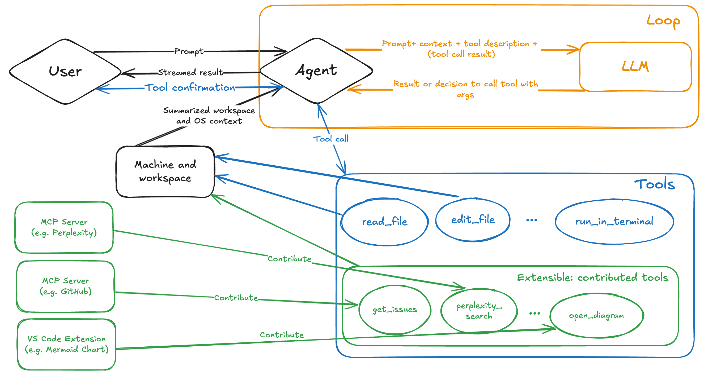

[← 前のレッスン: Agent mode][previous-lesson] · [次のレッスン: カスタムエージェント →][next-lesson]

agent mode でフィルター機能を構築しました。pull request を作成する前に、ブラウザーで実際に動作することを確認します。自分でアプリを操作する代わりに **Playwright MCP サーバー**を接続し、Copilot に実際のブラウザーを操作させて機能をテストします。その後、ブランチを公開して PR を作成します。

この演習では、次の内容を学びます。

- Model Context Protocol (MCP) と、MCP サーバーが Copilot にツールを追加する仕組みを理解する。
- Playwright MCP サーバーをワークスペースに追加する。
- Copilot に Playwright MCP を使わせて、ブラウザーでフィルター機能を手動テストする。
- ブランチを公開し、フィルター機能の pull request を作成する。

## Model Context Protocol (MCP) とは

エディターの外部にあるツールを利用できると、agent mode の機能が大きく広がります。Model Context Protocol (MCP) は、エージェントが外部のツールやサービスと通信するための標準的な方法です。



[Model Context Protocol (MCP)](https://github.blog/ai-and-ml/llms/what-the-heck-is-mcp-and-why-is-everyone-talking-about-it/) を使うと、AI エージェントが外部のツールやサービスと通信できます。MCP によって、エージェントはリソースを使って最新情報にアクセスしたり、ツールを使ってユーザーに代わって操作したりできます。

MCP サーバーは、AI エージェントと外部のツールやサービスとの間をつなぎます。既存の API や npm パッケージなどのローカルツールとの通信を管理します。MCP サーバーごとに、エージェントが利用できるツールやリソースのセットが異なります。

よく使われている MCP サーバーには、次のものがあります。

- **[GitHub MCP Server](https://github.com/github/github-mcp-server)**: GitHub リポジトリを管理する API を利用できます。リポジトリの作成や更新、Issue や pull request の管理などをエージェントに依頼できます。
- **[Playwright MCP Server](https://github.com/microsoft/playwright-mcp)**: Playwright によるブラウザー自動化機能を提供します。Web ページへの移動、フォームへの入力、ボタンの選択などをエージェントに依頼できます。

ほかにも、さまざまなツールやリソースを提供する MCP サーバーがあります。GitHub が公開している [MCP registry](https://github.com/mcp) を使うと、利用可能なサーバーを見つけて、エコシステムに貢献できます。

> [!CAUTION]
> MCP サーバーは、プロジェクト内の他の依存関係と同様に扱ってください。利用前にソースコードを確認し、発行元を検証して、セキュリティへの影響を検討します。信頼できる MCP サーバーだけを使い、機密情報や重要な操作へのアクセスを許可する際は注意してください。

## MCP の構成を確認する

`.vscode/mcp.json` ファイルで、この VS Code ワークスペースから利用できる MCP サーバーを設定します。

1. Codespace で `.vscode/mcp.json` を開きます。
2. `github` サーバーがすでに設定されています。

    ```json
    {
      "servers": {
        "github": {
          "type": "http",
          "url": "https://api.githubcopilot.com/mcp/"
        }
      }
    }
    ```

`github` の設定はプロジェクトのテンプレートに含まれています。そのため、前の演習では Copilot がバックログの Issue を読み取れました。この設定は[リモート GitHub MCP サーバー][remote-github-mcp-server]を使います。ローカルでインストールする必要はありません。VS Code は HTTP 経由で接続し、Copilot が初めてツールを使うときに GitHub で認証します。

## Playwright MCP サーバーを追加する

次に、2つ目のサーバーを追加します。[Playwright MCP サーバー][playwright-mcp-server]を使うと Copilot がブラウザーを操作できるため、実装した機能をテストできます。

1. `.vscode/mcp.json` で `github` と並べて `playwright` の設定を追加し、ファイルを次のようにします。

    ```json
    {
      "servers": {
        "github": {
          "type": "http",
          "url": "https://api.githubcopilot.com/mcp/"
        },
        "playwright": {
          "command": "npx",
          "args": ["@playwright/mcp@latest", "--headless"]
        }
      }
    }
    ```

2. ファイルを保存します。

リモートサーバーの `github` とは異なり、`playwright` は **ローカルサーバー**です。VS Code は `npx @playwright/mcp@latest` を実行して起動します。`--headless` フラグは、画面を表示せずにブラウザーを実行します。Codespace には表示用デスクトップがないため、この設定が必要です。

> [!NOTE]
> Tailspin Toys プロジェクトでは E2E テストに Playwright を使っているため、必要なブラウザーはすでにインストールされていることがほとんどです。Copilot がブラウザーがないと報告した場合は、`npx playwright install chromium` を実行させてから再試行してください。

## サーバーを起動して信頼する

VS Code は、MCP サーバーを必要に応じて起動します。Copilot がサーバーのツールを初めて使うときに起動し、サーバーを信頼するか確認します。

1. `.vscode/mcp.json` の `playwright` エントリの上に **Start** が表示されます。選択してサーバーを起動し、設定が正しいことを確認します。
2. サーバーを信頼するか VS Code に尋ねられた場合は、設定を確認し、サーバーを起動できるよう信頼する選択をします。

手動で起動する必要はありません。ここで起動しない場合は、次の手順で Copilot がツールを必要としたときに VS Code が起動し、信頼を確認します。

## フィルター機能をテストする

[Playwright MCP サーバー][playwright-mcp-server]を使うと、Copilot が実際のブラウザーを操作できます。ユーザー自身がページを開いてフィルターを確認する代わりに、エージェントにページの表示、移動、フィルターの適用、結果の読み取りを依頼できます。会話を続けたまま、機能が期待どおりに動くかをすばやく確認できます。

Playwright MCP サーバーは、スクリーンショットではなくページの[アクセシビリティツリー][playwright-mcp-server]を使います。そのため、エージェントはボタン、リンク、リスト項目など、ラベル付きの構造化された要素を基に判断します。支援技術と同じ情報を使うため、簡単な機能テストでアクセシビリティも確認できます。

サーバーを接続し、アプリを起動した状態で、Copilot に作成したフィルター機能をテストするよう依頼します。

```text
Playwright MCP サーバーを使って、実行中のアプリ http://localhost:4321 をブラウザーで開き、新しいゲームのフィルター機能を確認してください。

1. ゲームのページに移動し、表示されているゲームの数を確認します。
2. カテゴリーフィルターを適用し、そのカテゴリーのゲームだけが表示されることを確認します。
3. フィルターを解除してからパブリッシャーフィルターを適用し、そのパブリッシャーのゲームだけが表示されることを確認します。
4. カテゴリーとパブリッシャーのフィルターを組み合わせ、両方の条件が結果に反映されることを確認します。

各手順で確認したことを報告し、期待どおりに動作しない点があれば指摘してください。
```

Copilot は Playwright MCP サーバーを介してブラウザーを起動し、各手順を実行して結果を報告します。報告内容を Issue の受け入れ条件と照らし合わせます。問題があれば、pull request を作成する前に追加の質問をするか、コードを修正するよう依頼します。

> [!NOTE]
> テストを実行するには、アプリが `http://localhost:4321` で動作している必要があります。開発サーバーを停止した場合は、プロンプトを送る前に再起動します。Copilot が Playwright MCP サーバーを初めて使うときは、ブラウザーをダウンロードすることがあります。ブラウザーがないと報告された場合は、`npx playwright install chromium` を実行させてから再試行してください。

[playwright-mcp-server]: https://github.com/microsoft/playwright-mcp

## ブランチを公開して pull request を作成する

機能が動作することを確認できたので、チームのレビュー用に pull request (PR) を作成します。まず `filtering-vscode` ブランチを公開します。

1. Codespace の **Source Control** パネルを開き、Copilot が行った変更を確認します。
2. **+** アイコンを選択して変更をステージします。
3. **Sparkle** ボタンを使ってコミットメッセージを生成します。

   

4. **Publish** を選択して、ブランチをリポジトリにプッシュします。

## pull request を作成する

GitHub.com や GitHub コマンドラインインターフェイス (CLI) を使って pull request を作成できます。ここでは、Copilot に関連する Issue を見つけて PR を作成してもらいます。

1. Copilot Chat パネルに移動し、**New Chat** を選択して新しいセッションを開始します。
2. Copilot が GitHub ツールを使えるように、エージェントのドロップダウンで **Agent** が選択されていることを確認します。
3. 次のプロンプトで PR の作成を依頼します。

   ```plaintext
   リポジトリで、カテゴリーとパブリッシャーによる絞り込みに関する Issue を見つけてください。現在のブランチから pull request を作成し、対応する Issue に関連付けてください。
   ```

4. 必要に応じて **Continue** を選択し、情報の取得や操作を Copilot に許可します。GitHub ツールを初めて使うときは、GitHub への認証を求められることがあります。画面の指示に従ってください。
5. Copilot が Issue を検索し、該当するものを見つけて PR を作成します。
6. Copilot が生成したリンクを選択して PR を確認します。**まだマージしないでください。**

## まとめと次のステップ

この演習では、次の内容を学びました。

- Model Context Protocol (MCP) と、MCP サーバーが Copilot にツールを追加する仕組み
- Playwright MCP サーバーをワークスペースに追加する方法
- リリース前に MCP サーバーを使ってブラウザーで機能をテストする方法
- ブランチを公開して pull request を作成する方法

MCP サーバーを使って機能をテストしました。Copilot を拡張する方法は MCP だけではありません。次は[カスタムエージェントを作成して][next-lesson]、アクセシビリティレビューなど、対象を絞った作業を効率化します。

## リソース

- [MCP とは何か、なぜ注目されているのか][mcp-blog-post]
- [Microsoft Playwright MCP Server][playwright-mcp-server]
- [GitHub MCP Server][github-mcp-server]
- [GitHub MCP Registry][mcp-registry]
- [VS Code の MCP サーバー][vscode-mcp-config]

[previous-lesson]: ../2-agent-mode/
[next-lesson]: ../4-custom-agents/
[mcp-blog-post]: https://github.blog/ai-and-ml/llms/what-the-heck-is-mcp-and-why-is-everyone-talking-about-it/
[github-mcp-server]: https://github.com/github/github-mcp-server
[mcp-registry]: https://github.com/mcp
[remote-github-mcp-server]: https://github.blog/changelog/2025-06-12-remote-github-mcp-server-is-now-available-in-public-preview/
[vscode-mcp-config]: https://code.visualstudio.com/docs/agents/reference/mcp-configuration
